  <a href="https://mentria.ai">
    <picture>
      <source media="(max-width: 600px) and (prefers-color-scheme: light)" srcset="assets/hero-light-mobile.svg">
      <source media="(max-width: 600px)" srcset="assets/hero-dark-mobile.svg">
      <source media="(prefers-color-scheme: light)" srcset="assets/hero-light.svg">
      
    </picture>
  </a>

  🌐 <a href="https://mentria.ai">mentria.ai</a> &nbsp;·&nbsp;
  ⭐ <a href="https://github.com/mentria-ai/website">Star the website</a> &nbsp;·&nbsp;
  ♥ <a href="https://github.com/sponsors/mentria-ai">Sponsor</a>

## Who builds this

Mentria is built by one developer who would rather stay anonymous. There are no investors and no team, and there's no face to put on it. The work should speak for itself, and keeping my identity private comes from the same belief as keeping yours private.

I want technology that respects your privacy, stays open for anyone to read, and reaches as close to the cutting edge as a browser allows. So I write the engine that runs some of the best open AI models right on your device, and I build every tool around it. The aim is to give people their agency back.

## What I'm building

- **[website](https://github.com/mentria-ai/website)**: mentria.ai, a WebGPU inference engine written from scratch and the tools built on it. AI chat with vision, customizable models with swappable adapters, games, phone sensors and everyday utilities, in five languages and mostly offline. Your data stays private.
- **[radio-catalog](https://github.com/mentria-ai/radio-catalog)**: the catalog behind Infinite Radio.
- **[awesome-local-ai](https://github.com/mentria-ai/awesome-local-ai)** and **[awesome-webgpu](https://github.com/mentria-ai/awesome-webgpu)**: reading lists for running AI on your own hardware.

## Support the work

If Mentria is useful to you, a ⭐ on [the website repo](https://github.com/mentria-ai/website) helps other people find it, and [sponsoring](https://github.com/sponsors/mentria-ai) helps keep it going. Issues and pull requests are welcome too.

Your data stays private. Your agency stays yours.

